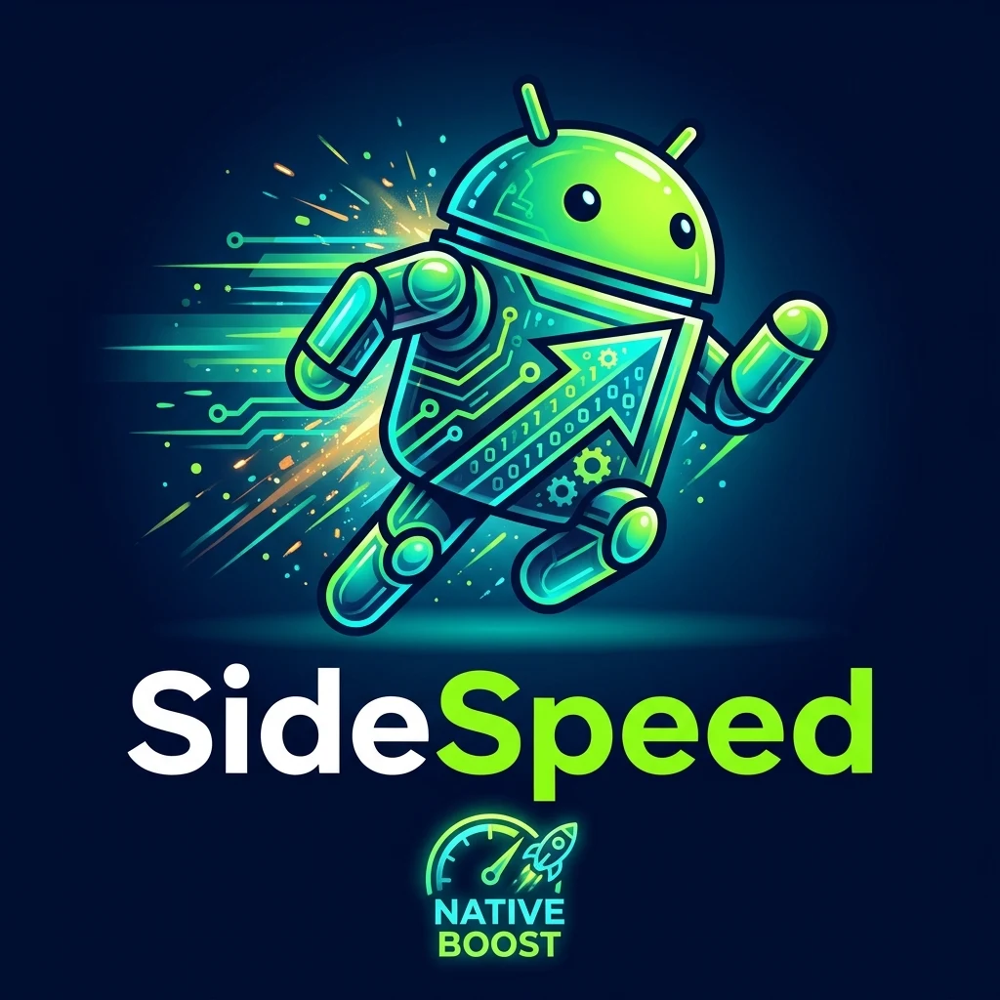

# SideSpeed



One-tap speed boost for sideloaded Android TV apps. It compiles them to native code the way Play Store installs are. Automatic recompiling after app updates is planned.

## Install
Sideload the release APK onto your TV (for example with `adb install` or a file-transfer app). SideSpeed appears on the home screen.

## Setup
SideSpeed needs a helper running as the shell user. It starts from the APK itself and the app guides you through it.

- **Fire TV / Fire OS:** turn on ADB debugging (Settings > My Fire TV > Developer options). The app shows the `adb` commands to run from a PC on the same network (connect, then one `adb shell` command) each time the helper needs starting.
- **Google TV / Android TV (e.g. onn 4K Pro):**
  1. Turn on Wireless debugging (Settings > System > Developer options).
  2. Open SideSpeed. When the TV asks "Allow debugging?", tick **Always allow**, then **Allow**.
  3. SideSpeed starts its helper by itself and shows your apps. No PC and no pairing code are needed.

  If your TV doesn't accept direct connections (SideSpeed tells you after a few tries), choose **Pair with a code instead** and enter the code and port from "Pair device with pairing code" with the D-pad. Starting the helper from a PC also works.

## Requirements and caveats
- ADB debugging (Fire TV) or Wireless debugging (Google TV) must stay on.
- Enabling it exposes ADB on your local network. Only use it on a network you trust; the app asks you to acknowledge this first.
- Restarting the TV, turning ADB off, or updating SideSpeed stops the helper (or leaves it out of date) and you must start it again. The onn turns Wireless debugging off after a reboot.
- `speed` compilation adds tens of MB of storage per app (approximately; see the design spec).
- A compile can take several minutes.

## Tested devices
| Device | Status |
|---|---|
| Fire TV Cube Gen 3, Fire OS 7.7.1.7 | Helper started from PC, compile verified |
| onn 4K Pro, Android 14 | Wireless debugging on + "Always allow" (classic connection on port 5555), helper auto-start and compile verified (no PC needed). Pairing with a code works; connecting over the paired TLS link is not yet verified |
| Other Android TV, Google TV and Fire TV devices | Should work |

## Building
```
./gradlew assembleRelease
```
For a signed APK, copy `keystore.properties.example` to `keystore.properties` and fill it in (or set the `SIDESPEED_*` environment variables). Without a keystore the release APK is unsigned.

## License
GPLv3, see `LICENSE`. Third-party attributions are in `NOTICE`.
